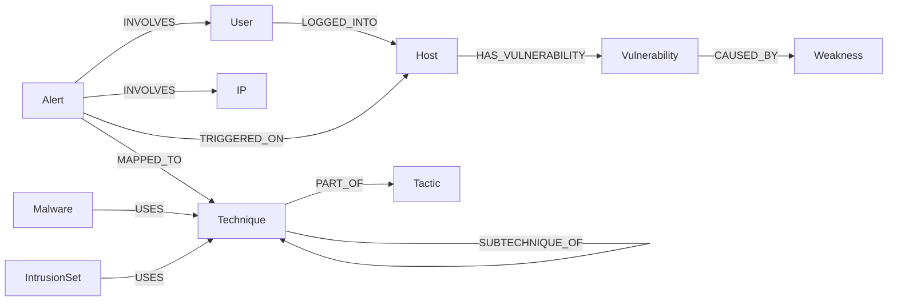

# Schéma du Knowledge Graph

Base : Neo4j. Ce document est le contrat entre les modules (KG, RAG, agents, API, dashboard) : tous utilisent les mêmes noms de nœuds, de propriétés et de relations.

## Nœuds

| Label | Clé unique | Propriétés | Source | Statut |
|---|---|---|---|---|
| Alert | alert_id | severity, rule_id, rule_desc, timestamp | Wazuh (JSON normalisé) | Importé |
| Host | hostname | os, criticality | Wazuh | Importé |
| IP | address | is_internal | Wazuh | Importé |
| User | username | | Wazuh | Importé |
| Vulnerability | cve_id | cvss, description | NVD (CVE) | Importé |
| Weakness | cwe_id | name | MITRE (CWE) | Importé |
| Technique | attack_id | name, description, stix_id | MITRE ATT&CK | Importé |
| Tactic | shortname | name, attack_id | MITRE ATT&CK | Importé |
| Malware | name | description | MITRE ATT&CK | Importé |
| IntrusionSet | name | description | MITRE ATT&CK | Importé |

## Schéma des relations



## Liste des relations

| Relation | Source | Cible | Origine des données |
|---|---|---|---|
| TRIGGERED_ON | Alert | Host | Wazuh |
| INVOLVES | Alert | IP | Wazuh |
| INVOLVES | Alert | User | Wazuh |
| MAPPED_TO | Alert | Technique | Wazuh (règle MITRE) |
| PART_OF | Technique | Tactic | MITRE ATT&CK |
| SUBTECHNIQUE_OF | Technique | Technique | MITRE ATT&CK |
| HAS_VULNERABILITY | Host | Vulnerability | Scan / Wazuh |
| CAUSED_BY | Vulnerability | Weakness | NVD (CVE vers CWE) |
| USES | Malware | Technique | MITRE ATT&CK |
| USES | IntrusionSet | Technique | MITRE ATT&CK |
| LOGGED_INTO | User | Host | Wazuh |

## Contraintes d'unicité

Créées par `kg/create_constraints.py` :

| Label | Propriété unique |
|---|---|
| Technique | attack_id |
| Tactic | shortname |
| Vulnerability | cve_id |
| Weakness | cwe_id |
| Alert | alert_id |
| Host | hostname |
| IP | address |
| User | username |
| Malware | name |
| IntrusionSet | name |

## Exemples de requêtes

Technique et tactique associées à chaque alerte :

```cypher
MATCH (a:Alert)-[:MAPPED_TO]->(t:Technique)-[:PART_OF]->(c:Tactic)
RETURN a.alert_id, t.name, c.name
```

Nombre de techniques par tactique :

```cypher
MATCH (t:Technique)-[:PART_OF]->(c:Tactic)
RETURN c.name, count(t) ORDER BY count(t) DESC
```

Groupes d'attaquants qui utilisent une technique donnée :

```cypher
MATCH (g:IntrusionSet)-[:USES]->(t:Technique {attack_id: 'T1110'})
RETURN g.name
```
Groupes d'attaquants qui utilisent une technique donnée :

```cypher
MATCH (g:IntrusionSet)-[:USES]->(t:Technique {attack_id: 'T1110'})
RETURN g.name
```


## Format des alertes normalisées (Wazuh vers KG)

Source : `data/alerts_sample.json` (produit par Sakina, format détaillé dans `docs/api.md`). Import : `python kg/import_alerts.py`.

| Champ JSON | Type | Devient dans Neo4j |
|---|---|---|
| alert_id | string | `Alert.alert_id` (clé unique) |
| timestamp | string (ISO 8601) | `Alert.timestamp` |
| severity | entier (0 à 15, niveau Wazuh) | `Alert.severity` |
| rule_id | string | `Alert.rule_id` |
| rule_desc | string | `Alert.rule_desc` |
| hostname | string | `Host.hostname` + relation `(Alert)-[:TRIGGERED_ON]->(Host)` |
| src_ip | string ou null | `IP.address` + relation `(Alert)-[:INVOLVES {role:'src'}]->(IP)` |
| dst_ip | string ou null | `IP.address` + relation `(Alert)-[:INVOLVES {role:'dst'}]->(IP)` |
| user | string ou null | `User.username` + relation `(Alert)-[:INVOLVES]->(User)` |
| mitre_technique | string ou null | `(Alert)-[:MAPPED_TO]->(Technique)` ; valeur d'origine gardée dans `Alert.mitre_raw` |

### Règles de l'import

- **Valeurs null** : un nœud `IP` ou `User` n'est créé que si la valeur existe. Une alerte sans `alert_id` ou sans `hostname` est ignorée.
- **`INVOLVES` vers une IP** porte une propriété `role` (`src` pour l'attaquant, `dst` pour la cible).
- **`IP.is_internal`** est calculée par l'import (adresse privée ou non).
- **`LOGGED_INTO`** `(User)-[:LOGGED_INTO]->(Host)` est créée uniquement pour la règle Wazuh 5501 (« PAM: Login session opened »), seule preuve de connexion réelle.
- **Identifiants MITRE renommés** : Wazuh envoie parfois d'anciens identifiants absents d'ATT&CK actuel. La table `TECH_ALIASES` de `kg/import_alerts.py` fait la correspondance (ex. `T1562.001` vers `T1685`). L'identifiant d'origine reste dans `Alert.mitre_raw`.
- **Import répétable** : le script utilise `MERGE`, donc relancer l'import sur un nouveau fichier n'crée pas de doublons : `python kg/import_alerts.py chemin/vers/alertes.json`.

## Reconstruire le graphe

Depuis la racine du dépôt, avec Neo4j démarré et un fichier `.env` rempli (modèle : `.env.example`) :

```
python kg/create_constraints.py
python kg/import_attack.py
python kg/check_graph.py
python kg/import_cve_cwe.py
python kg\import_alerts.py
```
