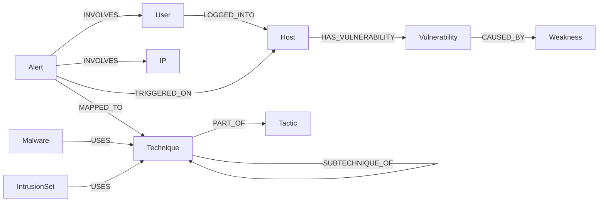

# Schéma du Knowledge Graph

Base : Neo4j. Ce document est le contrat entre les modules (KG, RAG, agents, API, dashboard) : tous utilisent les mêmes noms de nœuds, de propriétés et de relations.

## Nœuds

| Label | Clé unique | Propriétés | Source | Statut |
|---|---|---|---|---|
| Alert | alert_id | severity, rule_id, rule_desc, timestamp | Wazuh (JSON normalisé) | À faire (S3) |
| Host | hostname | os, criticality | Wazuh | À faire (S3) |
| IP | address | is_internal | Wazuh | À faire (S3) |
| User | username | | Wazuh | À faire (S3) |
| Vulnerability | cve_id | cvss, description | NVD (CVE) | Importé |
| Weakness | cwe_id | name | MITRE (CWE) | Importé |
| Technique | attack_id | name, description, stix_id | MITRE ATT&CK | Importé |
| Tactic | shortname | name, attack_id | MITRE ATT&CK | Importé |
| Malware | name | description | MITRE ATT&CK | Importé |
| IntrusionSet | name | description | MITRE ATT&CK | Importé |

## Schéma des relations



## Liste des relations

| Relation | Source | Cible | Origine des données |
|---|---|---|---|
| TRIGGERED_ON | Alert | Host | Wazuh |
| INVOLVES | Alert | IP | Wazuh |
| INVOLVES | Alert | User | Wazuh |
| MAPPED_TO | Alert | Technique | Wazuh (règle MITRE) |
| PART_OF | Technique | Tactic | MITRE ATT&CK |
| SUBTECHNIQUE_OF | Technique | Technique | MITRE ATT&CK |
| HAS_VULNERABILITY | Host | Vulnerability | Scan / Wazuh |
| CAUSED_BY | Vulnerability | Weakness | NVD (CVE vers CWE) |
| USES | Malware | Technique | MITRE ATT&CK |
| USES | IntrusionSet | Technique | MITRE ATT&CK |
| LOGGED_INTO | User | Host | Wazuh |

## Contraintes d'unicité

Créées par `kg/create_constraints.py` :

| Label | Propriété unique |
|---|---|
| Technique | attack_id |
| Tactic | shortname |
| Vulnerability | cve_id |
| Weakness | cwe_id |
| Alert | alert_id |
| Host | hostname |
| IP | address |
| User | username |
| Malware | name |
| IntrusionSet | name |

## Exemples de requêtes

Technique et tactique associées à chaque alerte :

```cypher
MATCH (a:Alert)-[:MAPPED_TO]->(t:Technique)-[:PART_OF]->(c:Tactic)
RETURN a.alert_id, t.name, c.name
```

Nombre de techniques par tactique :

```cypher
MATCH (t:Technique)-[:PART_OF]->(c:Tactic)
RETURN c.name, count(t) ORDER BY count(t) DESC
```

Groupes d'attaquants qui utilisent une technique donnée :

```cypher
MATCH (g:IntrusionSet)-[:USES]->(t:Technique {attack_id: 'T1110'})
RETURN g.name
```

## Format attendu des alertes normalisées (Wazuh vers KG)

Champs nécessaires pour peupler le graphe : `alert_id`, `timestamp`, `severity`, `rule_id`, `rule_desc`, `hostname`, `src_ip`, `dst_ip`, `user`, `mitre_technique` (attack_id).

## Reconstruire le graphe

Depuis la racine du dépôt, avec Neo4j démarré et un fichier `.env` rempli (modèle : `.env.example`) :

```
python kg/create_constraints.py
python kg/import_attack.py
python kg/check_graph.py
python kg/import_cve_cwe.py
```
